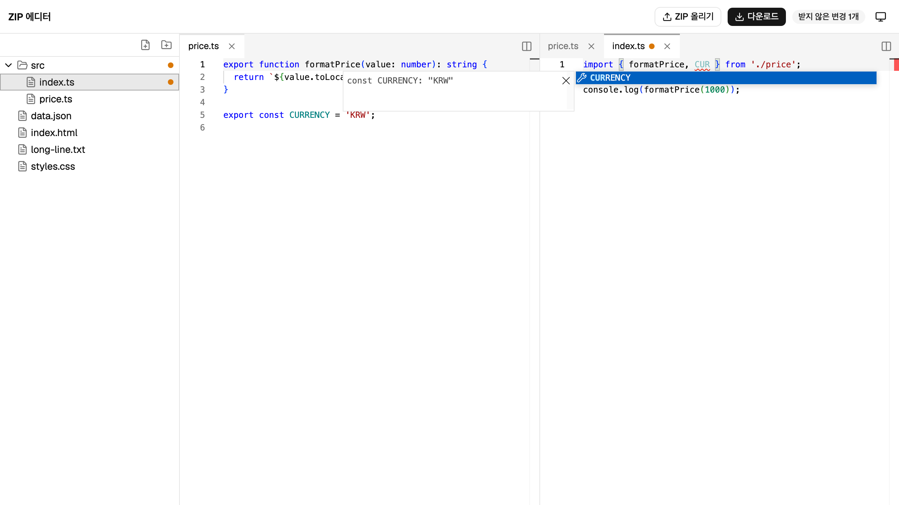
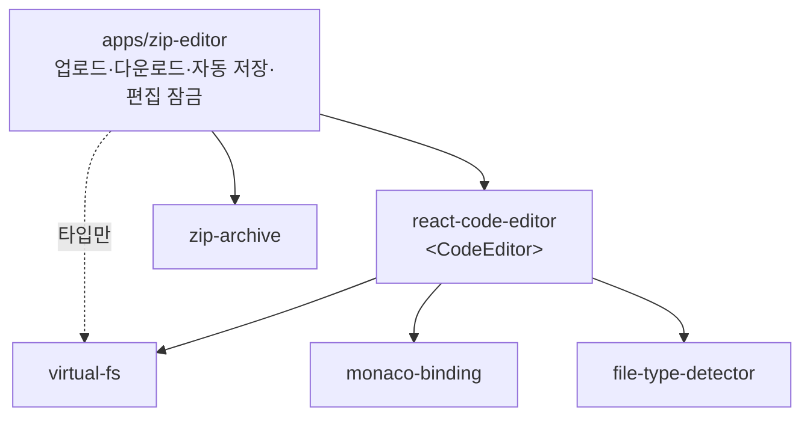
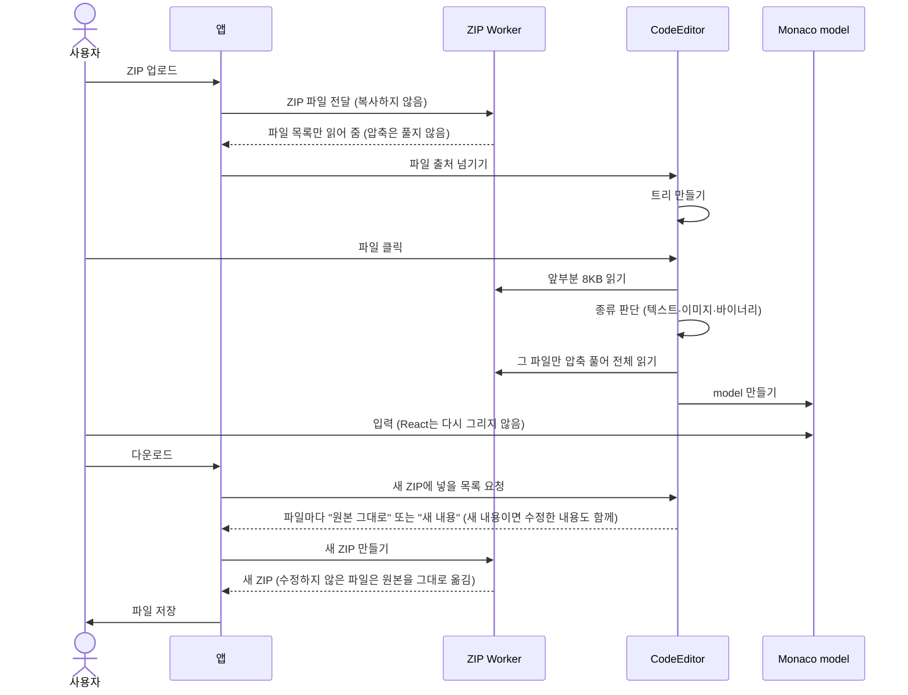

# Codefold

브라우저에서 ZIP 안의 코드를 바로 고치는 에디터입니다. ZIP 파일을 업로드해 안의 파일을 수정하고, 수정한 내용이 반영된 ZIP을 다시 다운로드합니다. 파일은 트리와 탭으로 열고, 코드 에디터(Monaco)에서 수정합니다. 새로고침하거나 브라우저를 닫았다 열어도 하던 작업을 이어서 할 수 있습니다.

**배포 주소: [https://codefold-zip-editor.vercel.app](https://codefold-zip-editor.vercel.app)**



위 화면은 TS 프로젝트 ZIP을 열어 두 파일을 나란히 띄운 모습입니다. 오른쪽 `index.ts`의 `import` 문에 `CUR`까지 입력하자, 왼쪽 `price.ts`가 내보내는 `CURRENCY`가 자동 완성 목록에 나옵니다. 수정한 파일에는 파일 트리와 탭에 주황색 점이 붙고, 화면 오른쪽 위에는 받지 않은 변경 수가 보입니다.

에디터 부분은 다른 서비스에서도 가져다 쓸 수 있도록 패키지로 나누었습니다. 이 저장소의 앱(`apps/zip-editor`)은 그 패키지를 쓰는 첫 번째 사례입니다.

## 숫자로 보는 결과

| 항목 | 결과 |
|---|---|
| 빠르게 입력할 때 React 렌더 | 100글자를 입력하는 동안 **1회**. 파일에 수정 표시가 처음 붙을 때만 그립니다. |
| 파일이 많은 ZIP 열기 | 파일 1만 개 ZIP의 트리가 **0.50초**, 5만 개는 **0.59초** 만에 보입니다. |
| 첫 화면 JS 크기 | gzip **131.5KB**. Monaco(약 683KB)는 ZIP을 열 때 따로 내려받습니다. |
| 입력 중 긴 작업(50ms 초과) | **0건** |
| 테스트 | 단위·통합 테스트 **740개**, E2E 테스트 **41개 × 브라우저 3종**(Chromium·Firefox·WebKit) |

렌더 횟수와 첫 화면 JS 크기는 CI가 매번 재고, 목표를 넘으면 CI가 실패합니다. 자세한 측정 방법과 환경은 [성능 보고서](docs/performance-report.md)에 있습니다.

## 목차

- [주요 기능](#주요-기능)
- [기술적으로 풀어 본 문제](#기술적으로-풀어-본-문제)
- [실행 방법](#실행-방법)
- [먼저 알아 둘 말](#먼저-알아-둘-말)
- [저장소 구조](#저장소-구조)
- [재사용 구조와 개발 환경](#재사용-구조와-개발-환경)
- [아키텍처](#아키텍처)
- [성능](#성능)
- [테스트](#테스트)
- [핵심 결정](#핵심-결정)
- [알려진 한계와 다음 단계](#알려진-한계와-다음-단계)
- [개발 규칙](#개발-규칙)
- [라이선스](#라이선스)

## 주요 기능

| 기능 | 내용 | 위치 |
|---|---|---|
| ZIP 열기와 다시 받기 | 파일을 고르거나 끌어다 놓아 ZIP을 엽니다. 다운로드 버튼은 원본과 달라진 내용이 있을 때만 켜지고, 수정한 내용이 반영된 ZIP을 원래 이름으로 저장합니다. | [`openFlow.ts`](apps/zip-editor/src/business/hooks/session/openFlow.ts), [`downloadFlow.ts`](apps/zip-editor/src/business/hooks/session/downloadFlow.ts) |
| 직접 만든 ZIP 해석 | 외부 ZIP 라이브러리 없이 ZIP 형식을 직접 읽고 씁니다. 아주 크거나 파일이 많은 ZIP(ZIP64 형식)과 한글 파일 이름도 읽습니다. ZIP 안에는 폴더 구조가 따로 없고 `src/a.ts` 같은 경로만 있으므로, 경로를 `/`로 나눠 폴더 트리를 만듭니다. | [`zip-archive`](packages/zip-archive/README.md) ([`central.ts`](packages/zip-archive/src/central.ts)), [`virtual-fs`](packages/virtual-fs/README.md) ([`build.ts`](packages/virtual-fs/src/build.ts)) |
| 파일 트리 | 파일·폴더를 추가하고, 지우고, 이름을 바꿉니다. 파일이 수만 개여도 화면에 보이는 줄만 그립니다. | [`virtual-fs.ts`](packages/virtual-fs/src/virtual-fs.ts), [`file-tree-panel.tsx`](packages/react-code-editor/src/tree/file-tree-panel.tsx) |
| 탭과 화면 나누기 | 트리에서 고른 파일을 탭으로 엽니다. 탭을 끌어서 화면을 좌우나 위아래로 나눌 수 있습니다. 수정한 파일의 탭을 닫아도 내용은 남아서, 다시 열면 이어서 수정합니다. | [`react-code-editor`](packages/react-code-editor/README.md) ([`dockview-area.ts`](packages/react-code-editor/src/area/dockview-area.ts)) |
| 파일 종류 판단 | 확장자 대신 파일 앞부분 8KB를 보고 이미지·텍스트·바이너리를 구분합니다. 이미지는 바로 보여 주고, 텍스트는 에디터로 열고, 바이너리는 열지 않습니다. UTF-8·UTF-16·EUC-KR 같은 글자 인코딩도 판단합니다. | [`file-type-detector`](packages/file-type-detector/README.md) ([`detect.ts`](packages/file-type-detector/src/detect.ts)), [`file-panel.tsx`](packages/react-code-editor/src/views/file-panel.tsx) |
| 편집과 undo/redo | undo 기록은 파일마다 따로 있어서, 탭을 오가도 사라지지 않습니다. Ctrl(Cmd)+Z와 Ctrl(Cmd)+Shift+Z로 되돌리고 다시 합니다. | [`monaco-binding`](packages/monaco-binding/README.md) ([`keybindings.ts`](packages/monaco-binding/src/keybindings.ts)) |
| 자동 완성·문법 강조·테마 | TS·JS 파일을 편집할 때는 열린 다른 파일의 함수와 타입까지 자동 완성 목록에 나옵니다. 문법 강조는 81개 언어를 지원합니다. 테마는 라이트·다크·시스템 중에서 고릅니다. | [`load-monaco.ts`](packages/react-code-editor/src/monaco/load-monaco.ts), [`useTheme.ts`](apps/zip-editor/src/business/hooks/theme/useTheme.ts) |
| 자동 저장과 복원 | 저장 버튼이 없습니다. 수정한 내용과 트리 변경, 탭 배치를 브라우저(IndexedDB)에 자동으로 저장하고, 새로고침하거나 브라우저를 닫았다 열면 이어서 할지 고르는 안내가 뜹니다. | [`autosave/`](apps/zip-editor/src/business/hooks/autosave), [`restoreFlow.ts`](apps/zip-editor/src/business/hooks/session/restoreFlow.ts) |
| 편집 잠금 | 같은 작업을 브라우저 탭 두 개에서 열면 편집은 한 탭에서만 됩니다. 다른 탭에서 "여기서 열기"로 편집 권한을 가져올 수 있습니다. | [`lockFlow.ts`](apps/zip-editor/src/business/hooks/session/lockFlow.ts) |
| 다른 서비스에서 쓰는 에디터 | 화면 없이 기능만 있는 패키지 4개와, 이를 조립한 React 패키지 1개로 나누었습니다. 라이브러리 모드로 빌드합니다. | [재사용 구조와 개발 환경](#재사용-구조와-개발-환경) |

## 기술적으로 풀어 본 문제

### 1. 빠르게 입력해도 React가 다시 그리지 않게

- **문제:** 파일 내용을 React 상태에 두면 키를 누를 때마다 렌더가 일어납니다.
- **접근:** 파일 내용은 Monaco model에만 둡니다. `monaco-binding`은 model의 버전 번호를 열 때의 기준값과 비교해 수정 여부를 계산하고, 수정 여부가 **바뀔 때만** 알립니다. 트리의 각 줄은 자기 경로의 수정 여부만 구독합니다.
- **결과:** 100글자를 입력하는 동안 React 렌더는 첫 글자를 입력할 때의 1회뿐입니다.
- **관련 결정:** [ADR-0006](docs/adr/0006-monaco-model-as-content-source.md), [ADR-0009](docs/adr/0009-modified-vs-unexported-state.md), [ADR-0019](docs/adr/0019-react-compiler.md)

### 2. 1GB ZIP도 메모리에 다 올리지 않게

- **문제:** ZIP을 열 때 전체를 읽고 풀면 큰 ZIP에서 메모리가 모자라고 화면이 멈춥니다.
- **접근:** ZIP 끝의 목차만 읽어 트리를 만들고, 파일은 열 때 그 파일만 풉니다. 업로드한 파일은 `Blob`으로 두고 필요한 구간만 `slice`로 읽습니다. 압축 해제와 압축은 Web Worker에서 하고, 풀린 바이트는 복사 없이 transfer로 넘깁니다.
- **결과:** 파일 1만 개 ZIP의 트리가 0.5초 만에 보이고, 파일 수가 5배로 늘어도 0.09초만 늘어납니다.
- **관련 결정:** [ADR-0001](docs/adr/0001-zip-parser-in-house.md), [ADR-0028](docs/adr/0028-zip-work-in-web-worker.md), [ADR-0029](docs/adr/0029-virtualized-file-tree.md)

### 3. 고친 파일만 다시 압축하게

- **문제:** 다운로드할 때 모든 파일을 풀었다가 다시 압축하면 큰 ZIP에서 오래 걸립니다.
- **접근:** 고치지 않은 파일은 원본 ZIP의 압축된 바이트를 CRC까지 그대로 옮깁니다. 고친 파일만 브라우저 내장 `CompressionStream`으로 다시 압축합니다. 고쳤다가 되돌려 원본과 같아진 파일은 다운로드할 때 바이트를 비교해 확인하고, 원본의 압축된 바이트를 그대로 옮깁니다. 결과 ZIP은 조각을 이어 붙인 `Blob`이라 원본 바이트를 메모리로 복사하지 않습니다.
- **관련 결정:** [ADR-0032](docs/adr/0032-export-write-keeps-original-path.md), [ADR-0037](docs/adr/0037-zip-name-decoding-and-blob-write.md)

### 4. 여러 브라우저 탭이 저장한 내용을 덮어쓰지 않게

- **문제:** IndexedDB는 탭끼리 공유되므로, 두 탭이 같은 작업을 편집하면 나중에 저장한 쪽이 아무 경고 없이 앞의 저장을 덮어씁니다.
- **접근:** Web Locks API로 편집 권한을 한 탭에만 줍니다. 탭이 닫히거나 멈추면 브라우저가 잠금을 풀어 줍니다. 권한을 가져가는 탭은 먼저 BroadcastChannel로 "저장 끝남" 신호를 기다리기 시작한 뒤 잠금을 가져옵니다. 신호가 오거나 1초가 지나면 저장본을 읽습니다. 권한을 빼앗긴 탭은 곧바로 읽기 전용이 되고, 하던 저장을 마친 뒤 신호를 보냅니다.
- **관련 결정:** [ADR-0024](docs/adr/0024-single-tab-edit-lock.md), [ADR-0039](docs/adr/0039-read-only-tab-after-losing-lock.md), [ADR-0040](docs/adr/0040-pending-save-and-protecting-saved-copy.md)

### 5. 측정이 고장 나도 통과하지 않는 성능 테스트

- **문제:** React 공식 `<Profiler>`는 운영 빌드에서 꺼져 있습니다. 그리고 "렌더 0회"만 확인하면, 측정 도구가 고장 나 늘 0이 나와도 테스트가 통과합니다.
- **접근:** 운영 빌드의 React도 커밋마다 개발자 도구 훅을 부릅니다. 이 훅 대신 커밋 수만 세는 가짜 훅을 넣어 둡니다. 99글자 동안 0회인지 확인하면서, 반드시 렌더가 일어나는 첫 글자에서는 0보다 큰지도 함께 확인합니다.
- **관련 결정:** [ADR-0027](docs/adr/0027-performance-budgets.md), [ADR-0045](docs/adr/0045-render-count-via-devtools-hook.md)

## 실행 방법

Node.js 24와 pnpm 11이 필요합니다. nvm을 쓰면 `nvm use`로 저장소의 `.nvmrc`에 적힌 버전(24)에 맞춥니다. pnpm은 `corepack enable`을 실행하면 `package.json`에 적힌 버전(11.6.0)을 씁니다.

저장소를 처음 받았다면 아래 명령을 차례로 실행해 바로 시험해 볼 수 있습니다.

```bash
pnpm install
pnpm --filter @codefold/zip-editor samples   # 샘플 ZIP을 apps/zip-editor/samples/에 만든다
pnpm dev                                     # 개발 서버 실행. http://localhost:5173 에서 samples/basic.zip을 올려 본다
```

샘플 폴더(`apps/zip-editor/samples/`)는 git에 올리지 않으므로, 위의 `samples` 명령을 실행해야 생깁니다.

| 명령 | 하는 일 |
|---|---|
| `pnpm build` | 모든 패키지와 앱 빌드 |
| `pnpm test` | 단위 테스트 |
| `pnpm typecheck` | 타입 검사 |
| `pnpm lint` | 린트(패키지 사이 import 규칙 포함) |
| `pnpm --filter @codefold/zip-editor check:bundle` | 첫 화면 JS 크기 검사(빌드한 뒤) |
| `pnpm --filter @codefold/zip-editor exec playwright install` | E2E 테스트용 브라우저 설치(처음 한 번). Linux에서는 `--with-deps`를 붙여 필요한 시스템 라이브러리도 설치합니다. |
| `pnpm test:e2e` | E2E 테스트. 앱을 빌드하고 미리보기 서버를 띄운 뒤 실행합니다. 5173 포트에 이미 서버(`pnpm dev` 등)가 떠 있으면 E2E 테스트가 미리보기 서버 대신 그 서버에서 실행됩니다. 그럴 때는 그 서버를 먼저 끄거나 `E2E_PORT`로 포트를 바꿉니다. |
| `pnpm --filter @codefold/zip-editor perf` | 브라우저 성능 측정. 결과는 [성능 보고서](docs/performance-report.md)에 정리했습니다. |
| `pnpm --filter @codefold/zip-editor samples` | 직접 시험해 볼 샘플 ZIP을 `apps/zip-editor/samples/`에 만듭니다. 샘플 ZIP은 여섯 개입니다: 기본 프로젝트, TS 프로젝트, 이미지 모음, EUC-KR(옛 한글 인코딩) 텍스트, 파일 1만 개, ZIP이 아닌 파일. |

## 먼저 알아 둘 말

아래 설명에 자주 나오는 말입니다.

| 말 | 뜻 |
|---|---|
| 헤드리스 패키지 | 화면(React) 없이 기능만 담은 패키지. `zip-archive`, `file-type-detector`, `virtual-fs`, `monaco-binding` 네 개입니다. |
| 파일 출처(`FileSource`) | 에디터가 파일을 읽어 오는 곳. "파일 목록 주기, 앞부분 읽기, 전체 읽기" 세 가지만 할 수 있으면 무엇이든 파일 출처가 됩니다. 이 앱에서는 업로드한 ZIP입니다. |
| Monaco model | Monaco가 파일 하나의 내용과 undo 기록을 담아 두는 객체. 파일마다 하나씩 만듭니다. |
| 수정됨 | 파일 내용이 업로드한 원본과 다른 상태 |
| 받지 않은 변경 | 마지막으로 다운로드한 뒤에 더 수정한 내용 |
| 제어 API | 쓰는 쪽이 에디터 밖에서 에디터를 다루는 메서드 모음. 수정된 파일 내용 꺼내기, 수정 상태 구독 등이 있습니다. |

## 저장소 구조

pnpm workspace와 Turborepo로 여러 패키지를 한 저장소에서 관리합니다.

| 경로 | 하는 일 |
|---|---|
| `packages/zip-archive` | ZIP 파일 목록 읽기, 필요한 파일만 꺼내기, 새 ZIP 만들기 |
| `packages/file-type-detector` | 텍스트·이미지·바이너리 판단, 글자 인코딩 판단 |
| `packages/virtual-fs` | 파일 경로 목록으로 트리 만들기, 추가·삭제·이름 바꾸기 기록, 다운로드할 ZIP의 구성 정하기 |
| `packages/monaco-binding` | 파일별 Monaco model 관리, 수정 여부와 받지 않은 변경 추적 |
| `packages/react-code-editor` | 위 패키지를 조립한 에디터 컴포넌트 `<CodeEditor>` |
| `apps/zip-editor` | 실제 앱. ZIP 업로드·다운로드, 자동 저장과 복원, 브라우저 탭 하나에서만 편집하게 하는 잠금, 화면 구성 |

패키지 이름은 모두 `@codefold/` 뒤에 폴더 이름을 붙인 것입니다(예: `@codefold/zip-archive`). 패키지마다 README에 사용법과 한계를 적어 두었고, 설계를 그렇게 정한 이유는 [ADR(아키텍처 결정 기록)](docs/adr/README.md)에 있습니다.

## 재사용 구조와 개발 환경

이 에디터는 이 앱 하나만이 아니라 다른 서비스에도 붙일 수 있어야 합니다. 이 저장소는 그 방법을 문서가 아니라 구조로 보여 주도록 짰습니다.

### 모노레포로 나눈 이유

앱 하나 안에서 폴더로만 나누면, 경계는 폴더 이름뿐입니다. 누군가 실수로 허용하지 않은 방향으로 import해도 막을 장치가 없고, "다른 곳에서도 쓸 수 있다"는 말은 설명으로만 남습니다. 그래서 재사용할 단위를 실제 패키지로 나누었습니다([ADR-0003](docs/adr/0003-monorepo-package-split.md)).

- **경계를 도구가 지킵니다.** 패키지 사이의 import 방향은 ESLint 규칙으로 검사하고, 어기면 CI가 실패합니다.
- **패키지마다 따로 테스트합니다.** 헤드리스 패키지는 React나 브라우저 화면 없이 테스트할 수 있습니다. 단위·통합 테스트 740개 가운데 365개가 헤드리스 패키지의 테스트입니다.
- **밖에서 쓸 때와 같은 방식으로 씁니다.** 앱도 다른 서비스처럼 패키지의 공개 API만 씁니다. 앱이 잘 돌아가면 공개 API로 충분하다는 뜻입니다.
- **명령은 한 번에 돌립니다.** pnpm workspace가 패키지를 서로 연결합니다. Turborepo는 `build`·`test` 같은 명령을 의존 순서를 지키며 병렬로 실행하고, 결과를 캐시합니다([ADR-0004](docs/adr/0004-turborepo-task-runner.md)).

### 다른 서비스에서 쓰는 방법

필요한 만큼만 골라 씁니다.

| 필요한 것 | 설치할 패키지 | 쓰는 쪽이 넘길 것 |
|---|---|---|
| 트리·탭·에디터가 모두 있는 완성된 에디터 | `@codefold/react-code-editor` | 파일 출처, Monaco Worker를 만드는 함수. Worker를 불러오는 방법이 번들러마다 달라서 패키지가 정하지 않습니다. |
| React 없이 Monaco만 여러 파일에 연결 | `@codefold/monaco-binding` | `monaco-editor` 객체 |
| 브라우저에서 ZIP 읽기·쓰기 | `@codefold/zip-archive` | ZIP 파일(`Blob`) |
| 파일이 텍스트인지 이미지인지 판단 | `@codefold/file-type-detector` | 파일 앞부분 바이트 |

완성된 에디터는 이렇게 씁니다. 파일 출처만 만들어 넘기면 ZIP이 아닌 파일도 열 수 있습니다.

```tsx
import '@codefold/react-code-editor/styles.css';
import { CodeEditor } from '@codefold/react-code-editor';

<CodeEditor source={fileSource} createWorker={makeMonacoWorker} onReady={(editor) => { /* 다운로드·저장에 쓸 제어 API */ }} />
```

- `fileSource`: 쓰는 쪽이 만든 파일 출처입니다.
- `makeMonacoWorker`: 자동 완성·오류 표시 같은 Monaco 언어 기능을 돌릴 Worker를 만드는 함수입니다. 예시는 [react-code-editor README](packages/react-code-editor/README.md)에 있습니다.
- `onReady`로 받는 `editor`가 제어 API입니다.

다른 서비스에 붙였을 때 문제가 없도록 다음을 지켰습니다([ADR-0022](docs/adr/0022-react-ui-package.md), [ADR-0034](docs/adr/0034-react-code-editor-vite-library-build.md)).

- **라이브러리가 두 벌 들어가지 않습니다.** `react`, `react-dom`, `monaco-editor`는 peer dependency입니다. 이 패키지 안에 따로 넣지 않고, 쓰는 쪽이 설치한 버전을 함께 씁니다.
- **스타일이 섞이지 않습니다.** CSS 클래스에는 `cf:` 접두사를, CSS 변수에는 `--cf-` 접두사를 붙였습니다. 쓰는 쪽은 `--cf-` 변수를 덮어써 색과 간격을 바꿉니다. Tailwind를 쓰지 않는 서비스를 위해 빌드한 CSS 파일(`styles.css`)도 함께 내보냅니다.
- **밖에서 써도 성능이 같습니다.** 빌드한 코드에 React Compiler를 미리 적용해 두어서, 쓰는 쪽이 따로 설정하지 않아도 입력할 때 불필요한 렌더가 생기지 않습니다.
- **화면 문구를 바꿀 수 있습니다.** 문구는 prop으로 받고, 기본값은 한국어입니다.
- **서버 렌더링 환경에서 import해도 깨지지 않습니다.** Monaco는 브라우저에서만 불러옵니다.
- **다운로드와 저장은 쓰는 쪽이 정합니다.** 에디터는 수정된 파일 목록과 내용을 꺼내는 제어 API만 주고, 어디에 어떻게 저장할지는 서비스마다 정합니다.

### 개발 중 HMR: 패키지를 수정하면 앱에 바로 반영

HMR(Hot Module Replacement)은 코드를 저장하면 페이지를 새로고침하지 않고 바뀐 모듈만 새것으로 갈아 끼우는 기능입니다.

패키지를 나누면 흔히 생기는 문제가 있습니다. 패키지 코드를 수정할 때마다 그 패키지를 다시 빌드해야 앱에 반영되는 것입니다. 이 저장소에서는 앱과 개발 도구가 빌드한 파일 대신 패키지의 소스를 바로 읽게 해서 이 문제를 없앴습니다([ADR-0005](docs/adr/0005-internal-package-dual-exports.md)).

패키지의 `package.json`에는 조건마다 읽을 파일을 따로 적어 둡니다.

```jsonc
"exports": {
  ".": {
    "source": "./src/index.ts",     // 저장소 안: 소스를 바로 읽는다
    "types": "./dist/index.d.ts",   // 저장소 밖: 빌드한 파일을 읽는다
    "import": "./dist/index.js"
  }
}
```

저장소 안의 도구에만 `source` 조건을 켜 두었습니다.

| 도구 | 설정 | 효과 |
|---|---|---|
| Vite (개발 서버·빌드) | `resolve.conditions`에 `source` | 패키지 소스를 앱 코드처럼 읽어, 패키지 파일을 저장하면 앱 화면이 바로 바뀝니다(HMR). 파일이 바뀔 때마다 패키지를 다시 빌드하는 watch 빌드를 따로 켜 두지 않아도 됩니다. |
| Vitest (테스트) | 위와 같고, `ssr.resolve.conditions`에도 `source` | 패키지를 빌드하지 않아도 테스트를 돌릴 수 있습니다. Vitest는 Node 환경 테스트의 모듈을 서버 렌더링(SSR)용 설정으로 찾으므로, `ssr.resolve.conditions`에도 같은 조건을 켜야 합니다. |
| TypeScript (타입 검사) | `tsconfig.base.json`의 `customConditions: ["source"]` | VS Code 같은 코드 편집기의 "정의로 이동"이 `dist`가 아니라 소스로 갑니다. 빌드용 설정(`tsconfig.build.json`)에서는 끕니다. |
| Tailwind (스타일) | 앱 CSS에 `@source`로 패키지 소스 경로 추가 | 앱 개발 서버가 패키지 안의 `cf:` 클래스 스타일도 바로 만듭니다. |

`pnpm dev` 하나만 띄우면, 앱과 다섯 패키지 어디를 수정해도 브라우저에 바로 반영됩니다. 밖에서 설치하는 쪽은 `source` 조건을 모르므로, 빌드한 `dist`를 자동으로 읽습니다.

## 아키텍처

### 세 계층과 의존 방향



화살표는 "가져다 쓴다"는 뜻입니다. 점선은 실행되는 코드는 가져오지 않고 타입(`FileSource` 등)만 가져다 쓴다는 뜻입니다.

- **헤드리스 패키지**끼리는 서로 가져다 쓰지 않습니다. React에도 의존하지 않습니다.
- **`react-code-editor`**만 헤드리스 패키지를 조립합니다. ZIP에는 의존하지 않고, 파일은 파일 출처로만 받습니다.
- **앱**은 ZIP을 열어 파일 출처를 만들고 `<CodeEditor>`에 넘깁니다. 다른 서비스가 쓸 때와 똑같은 공개 API만 씁니다.
- `zip-archive`는 `virtual-fs`를 가져다 쓰지 않지만, 돌려주는 객체의 모양이 파일 출처와 같습니다. TypeScript는 타입 이름이 아니라 모양으로 호환 여부를 판단하므로, 앱이 둘을 그대로 이을 수 있습니다.
- 이 규칙은 ESLint로 검사하고, 어기면 CI가 실패합니다.

이렇게 나눈 덕분에 서버나 컴퓨터의 폴더처럼 ZIP이 아닌 곳에서 파일을 가져오는 서비스도, 파일 출처만 만들면 같은 에디터를 쓸 수 있습니다([ADR-0016](docs/adr/0016-workspace-layer-and-ports.md), [ADR-0022](docs/adr/0022-react-ui-package.md)).

앱 코드는 다섯 층으로 나눕니다. 위 층은 아래 층만 가져다 씁니다.

| 층 | 하는 일 |
|---|---|
| 페이지 (`pages/`) | 화면 배치 |
| 화면 컴포넌트 (`components/`) | 비즈니스 훅이 준 값을 그리기만 하는 층 |
| 비즈니스 훅 (`business/`) | 업로드, 다운로드, 복원 같은 흐름과 규칙 |
| 스토어 (`store/`) | 앱 상태(Zustand) |
| 서비스 (`services/`) | IndexedDB, Web Locks, Worker 같은 브라우저 기능. 브라우저 기능은 이 층에서만 다룹니다. |

### 데이터 흐름

ZIP을 업로드해 파일을 열고 수정한 뒤 다시 다운로드하기까지, 누가 무엇을 하는지 순서대로 그렸습니다.



- **파일 목록만 먼저 읽습니다.** ZIP 파일 끝에는 목차(Central Directory)가 있습니다. 목차만 읽어 트리를 만들고, 압축은 사용자가 파일을 열 때 그 파일만 풉니다([ADR-0001](docs/adr/0001-zip-parser-in-house.md)).
- **수정하지 않은 파일은 다시 압축하지 않습니다.** 원본 ZIP 안의 압축된 데이터를 그대로 옮깁니다. 수정한 파일만 원래 글자 인코딩으로 다시 써서 압축합니다. 예외로 EUC-KR 파일은 UTF-8로 씁니다([ADR-0037](docs/adr/0037-zip-name-decoding-and-blob-write.md)).

### Worker에서 하는 일

ZIP 파일 목록 읽기, 압축 풀기, 새 ZIP 만들기는 Web Worker에서 합니다. 그래서 큰 ZIP을 다루는 동안에도 입력과 스크롤이 멈추지 않습니다([ADR-0028](docs/adr/0028-zip-work-in-web-worker.md)).

- 업로드한 파일을 Worker에 넘길 때 파일 내용은 복사되지 않습니다. Worker는 필요한 부분만 잘라 읽습니다.
- 파일 내용을 주고받을 때도 복사하지 않고 메모리를 통째로 넘깁니다(transfer). 보낸 쪽은 그 메모리를 더 쓰지 못하고, 받는 쪽이 복사 없이 그대로 씁니다.
- `zip-archive`에는 스레드를 다루는 코드가 없습니다. Worker와 주고받는 메시지 형식은 앱의 `services/zip/` 한 곳에 모았습니다.
- Monaco의 TypeScript·JSON·CSS·HTML 언어 기능도 각각 별도 Worker에서 돌아갑니다. 그 언어의 파일을 처음 열 때 Worker를 만듭니다.

### 상태를 어디에 두나

편집에 쓰는 상태는 종류마다 두는 곳이 하나씩 정해져 있습니다.

| 상태 | 두는 곳 |
|---|---|
| 파일 내용, undo 기록 | Monaco model (`monaco-binding`이 파일마다 하나씩 관리) |
| 트리 구조, 추가·삭제·이름 바꾸기 기록 | `virtual-fs` |
| 탭과 화면 나누기 배치 | dockview (탭·분할 화면 라이브러리) |
| 파일별 수정 여부, 펼친 폴더, 지금 보고 있는 파일 | Zustand 스토어 (`<CodeEditor>`마다 하나) |
| 업로드 상태, 저장 상태, 테마, 편집 잠금 상태 | Zustand 스토어 (앱) |

파일 내용은 React 상태에 복사하지 않습니다([ADR-0006](docs/adr/0006-monaco-model-as-content-source.md)).

- 입력할 때마다 파일 내용을 읽지 않습니다. 수정됐는지는 Monaco가 매기는 버전 번호로 판단합니다. 이 번호는 입력하면 바뀌고, undo하면 이전 값으로 돌아갑니다.
- `monaco-binding`은 수정 여부가 **바뀔 때만** 알림을 보냅니다. 그래서 React는 파일이 처음 수정될 때와 undo로 원본과 같아질 때만 다시 그립니다.
- 각 컴포넌트는 자기가 보여 주는 파일의 값만 구독합니다. 메모이제이션은 React Compiler가 자동으로 처리합니다([ADR-0019](docs/adr/0019-react-compiler.md)).

"수정됨"과 "받지 않은 변경"은 따로 추적합니다([ADR-0009](docs/adr/0009-modified-vs-unexported-state.md)). 예를 들어 `a.ts`를 수정하고 다운로드한 뒤 `b.ts`를 수정하면, 두 파일 모두 "수정됨" 상태이지만 받지 않은 변경은 `b.ts` 하나입니다. 다운로드 버튼은 수정된 파일이 있으면 켜지고, 받지 않은 변경은 화면 위쪽에 "받지 않은 변경 N개"로 따로 보여 줍니다.

### 자동 저장과 복원

저장 버튼은 없습니다. 수정한 내용은 브라우저 저장소(IndexedDB)에 자동으로 저장됩니다([ADR-0014](docs/adr/0014-session-persistence-indexeddb.md)).


- **저장하는 것**: 원본 ZIP(업로드할 때 한 번), 수정한 파일의 내용, 트리 변경, 탭 배치, 다운로드 기록입니다. 수정하지 않은 파일은 원본 ZIP에서 다시 꺼낼 수 있으므로 저장하지 않습니다. 원본 ZIP은 수정 내용과 따로 저장해 두어서, ZIP이 커도 자동 저장이 느려지지 않습니다([ADR-0041](docs/adr/0041-indexeddb-zip-store-and-workspace-id.md)).
- **복원**: 앱을 열 때 저장된 작업이 있으면 이어서 할지 고르는 화면이 뜹니다. 이어 하면 원본 ZIP을 다시 읽고, 저장된 변경과 탭 배치를 복원합니다. undo 기록은 복원하지 않습니다. Monaco에 undo 기록을 꺼내는 공개 API가 없기 때문입니다.
- **다운로드 기록**: 다운로드할 때 수정한 파일마다 내용의 지문(SHA-256 해시)을 남깁니다. 새로고침하면 버전 번호가 처음부터 다시 시작하므로, 이 지문을 비교해 "다운로드한 뒤 더 수정했는지"를 판단합니다([ADR-0025](docs/adr/0025-download-record-content-hash.md)).
- **페이지를 떠날 때 경고**: 아직 저장하지 못한 입력이 있을 때만 띄웁니다. 받지 않은 변경만 있을 때는 이미 저장돼 있으므로 띄우지 않습니다.
- **편집은 브라우저 탭 하나에서만**: 같은 작업을 브라우저 탭 두 개에서 열면 저장한 내용이 서로 덮어써집니다. 그래서 브라우저의 Web Locks API로 편집 권한을 브라우저 탭 하나에만 줍니다. 다른 브라우저 탭에는 "여기서 열기" 버튼이 보이고, 누르면 권한을 가져옵니다([ADR-0024](docs/adr/0024-single-tab-edit-lock.md)).

### 파일 종류 판단

파일을 열 때 앞부분 8KB만 읽어서 판단합니다. 아래 순서대로 보다가, 먼저 결론이 나는 단계에서 멈춥니다([ADR-0031](docs/adr/0031-file-kind-detection-revised.md)).

1. 빈 파일이면 텍스트입니다.
2. 파일 맨 앞의 고유한 바이트(파일 서명)를 봅니다. PNG·JPEG·GIF·WebP 등이면 이미지이고, ZIP·PDF·글꼴·실행 파일 등이면 바이너리입니다.
3. 확장자를 봅니다. 바이너리 확장자(예: `.exe`)면 바이너리입니다. 이미지 확장자인데 서명이 맞지 않으면 다음 단계로 넘깁니다.
4. 내용을 봅니다. 인코딩 표시(BOM)가 있으면 그 인코딩으로 읽어 보고, 읽히면 텍스트이고 읽히지 않으면 바이너리입니다. BOM만 보고 정하지 않는 것은 BOM이 두세 바이트뿐이라 바이너리의 앞부분도 우연히 같을 수 있기 때문입니다([ADR-0044](docs/adr/0044-bom-must-decode.md)). 값이 0인 바이트는 텍스트 파일에 거의 나오지 않으므로, 이런 바이트가 있으면 바이너리입니다. UTF-8이나 EUC-KR로 읽히면 텍스트이고, 둘 다 안 되면 바이너리입니다.
5. `.svg` 파일이고 내용이 텍스트면 이미지로 보여 줍니다. "코드로 보기"를 누르면 텍스트로 수정할 수도 있습니다.

이미지는 `` 태그로만 보여 주므로 SVG 안의 스크립트는 실행되지 않습니다. 바이너리 파일은 열지 않고, 파일 크기와 바이너리로 판단한 이유를 보여 줍니다.

## 성능

목표는 [ADR-0027](docs/adr/0027-performance-budgets.md)에서 정했고, 실제 브라우저에서 잰 결과는 [성능 보고서](docs/performance-report.md)에 있습니다. 아래 표의 네 항목은 모두 목표를 통과했습니다.

| 항목 | 목표 | 결과 |
|---|---|---|
| 첫 화면 JS 크기 | gzip 150KB 이하 | **131.5KB**. 넘으면 CI가 실패합니다. |
| 키 입력당 React 렌더 | 0회 (수정 여부가 바뀔 때만 1회) | **첫 글자 1회, 이어서 친 99글자 0회**. 첫 글자에서 파일이 수정됨으로 바뀌므로 그때 한 번 그립니다. |
| 입력 중 50ms를 넘는 긴 작업 | 0건 | **0건**. 가장 오래 걸린 입력 처리는 24ms입니다. |
| 파일 1만 개 ZIP의 트리 표시 | 업로드 후 1초 이내 | **0.50초** (5회 중앙값). 파일 5만 개는 0.59초입니다. 기준 환경인 CI(GitHub Actions `ubuntu-latest`, 2코어)에서는 0.73초입니다. |

시간은 개발 PC(Apple M2 Pro)의 Chromium에서 운영 빌드로 잰 값입니다. `pnpm --filter @codefold/zip-editor perf`로 다시 잴 수 있습니다. CI도 `main`에 push할 때마다 같은 측정을 실행합니다. 렌더 횟수가 목표를 넘으면 CI가 실패하고, 시간 지표가 목표를 넘으면 경고를 남깁니다.

성능을 위해 한 일은 다음과 같습니다.

- **첫 화면에서 Monaco와 dockview를 뺐습니다.** 첫 화면에는 업로드 영역만 있습니다. 에디터 코드는 ZIP을 열기 시작할 때 함께 받아 오기 시작하므로, ZIP 목록을 읽는 동안 코드도 같이 받아 옵니다.
- **언어별 코드는 필요할 때 받습니다.** 81개 언어의 이름과 확장자만 먼저 등록해 두고, 문법 강조 규칙과 언어 기능은 그 언어의 파일을 처음 열 때 받습니다([ADR-0026](docs/adr/0026-monaco-language-loading.md)).
- **트리는 화면에 보이는 줄만 그립니다.** 파일이 수만 개여도 실제로 그리는 줄은 화면 높이만큼입니다(`@tanstack/react-virtual`). 그리지 않은 줄이 있어도, 스크린 리더는 각 줄이 "10개 중 3번째"처럼 전체에서 몇 번째인지 읽을 수 있습니다([ADR-0029](docs/adr/0029-virtualized-file-tree.md)).
- **자동 저장은 입력을 방해하지 않습니다.** 입력이 멈추고 브라우저가 한가할 때, 바뀐 파일만 읽어 저장합니다.

## 테스트

단위 테스트는 패키지마다 있고, E2E 테스트는 세 브라우저에서 실행합니다.

| 종류 | 도구 | 개수 |
|---|---|---|
| 단위·통합 테스트 | Vitest, Testing Library, fast-check(무작위 입력 테스트), fake-indexeddb | 740개 (zip-editor 203, react-code-editor 172, virtual-fs 117, file-type-detector 108, monaco-binding 72, zip-archive 68) |
| E2E 테스트 | Playwright (Chromium, Firefox, WebKit) | 41개 × 3개 브라우저 |

E2E 테스트는 실제 브라우저에서 다음을 확인합니다.

- ZIP을 업로드해 수정하고 다운로드한 뒤, 그 ZIP을 다시 업로드하면 수정한 내용이 그대로 있는지
- undo로 원본과 같아지면 다운로드 버튼이 다시 꺼지는지
- 새로고침하거나 브라우저를 강제로 닫았다 열어도 복원되는지
- 두 번째 브라우저 탭에서는 편집이 막히는지
- 마우스 없이 키보드만으로 쓸 수 있는지
- ZIP 안의 SVG·HTML 스크립트가 실행되지 않는지
- 파일 1만 개 ZIP에서도 열기·편집·다운로드가 멈추지 않는지
- 탭을 끌어 화면을 나누고, 두 그룹 사이 경계를 끌어 크기를 바꿀 수 있는지
- 두 그룹에 연 같은 파일에서 입력과 undo가 양쪽에 같이 반영되는지
- TS 파일에서 다른 TS 파일이 내보낸 이름을 자동 완성하는지
- 언어별 코드를 그 언어 파일을 처음 열 때만 받는지

E2E 테스트는 [`apps/zip-editor/e2e/`](apps/zip-editor/e2e)에 기능별로 있습니다. 자동 테스트로 확인하기 어려운 것(화면이 주는 느낌, 실제 Safari에서의 동작, 손으로 끌어 놓을 때의 동작)은 [직접 해 보는 테스트 시나리오](docs/manual-test-scenarios.md)로 확인합니다.

CI(GitHub Actions)는 포맷 검사, 린트, 타입 검사, 단위 테스트, 빌드, 첫 화면 JS 크기 검사, 세 브라우저 E2E 테스트를 실행합니다.

## 핵심 결정

결정 46개는 [ADR 목록](docs/adr/README.md)에 있습니다. 아래 표에는 그중 구조를 이해하는 데 필요한 것만 골랐습니다.

| 결정 | 이유 |
|---|---|
| ZIP 해석을 직접 구현한다 ([0001](docs/adr/0001-zip-parser-in-house.md)) | 목록만 읽기, 파일 하나만 풀기, 수정하지 않은 파일은 압축된 그대로 옮기기를 하려면 ZIP 구조를 직접 다뤄야 합니다. 압축 자체는 브라우저에 들어 있는 기능(`CompressionStream`)을 씁니다. |
| 파일 내용은 Monaco model에만 둔다 ([0006](docs/adr/0006-monaco-model-as-content-source.md)) | 입력할 때마다 React 상태를 바꾸지 않으므로, 빠르게 입력해도 화면을 다시 그리지 않습니다. |
| 패키지끼리 가져다 쓰지 않고 모양만 맞춘다 ([0016](docs/adr/0016-workspace-layer-and-ports.md), [0022](docs/adr/0022-react-ui-package.md)) | 패키지마다 따로 테스트하고, 따로 가져다 쓸 수 있습니다. |
| 탭과 화면 나누기는 dockview로 한다 ([0007](docs/adr/0007-dockview-editor-area.md)) | 탭 끌기, 화면 나누기, 크기 조절을 직접 만들지 않고 검증된 라이브러리를 씁니다. 첫 화면에서는 뺍니다. |
| 저장 버튼 없이 자동 저장한다 ([0008](docs/adr/0008-autosave-working-copy.md), [0014](docs/adr/0014-session-persistence-indexeddb.md)) | 브라우저를 닫아도 작업을 잃지 않습니다. 떠날 때 경고는 아직 저장하지 못한 입력이 있을 때만 띄웁니다. |
| ZIP 작업은 Web Worker에서 한다 ([0028](docs/adr/0028-zip-work-in-web-worker.md)) | 큰 ZIP을 다뤄도 화면이 멈추지 않습니다. |
| 편집 권한은 브라우저 탭 하나에만 준다 ([0024](docs/adr/0024-single-tab-edit-lock.md)) | 두 브라우저 탭이 저장한 내용을 서로 덮어쓰지 않게 합니다. |
| 스타일은 Tailwind CSS v4와 shadcn/ui로 한다 ([0002](docs/adr/0002-styling-tailwind-shadcn.md)) | 빌드할 때 CSS를 만들고 쓰지 않는 클래스는 빠지므로, 실행 중 비용이 없고 CSS가 작습니다. styled-components·emotion처럼 실행 중에 스타일을 만드는 방식은 입력 성능과 번들 크기에 불리합니다. |

기술 스택: TypeScript 6, React 19(React Compiler), Vite 8, Zustand 5, monaco-editor 0.57, dockview 8, Tailwind CSS 4, Vitest 5, Playwright 1.63

## 알려진 한계와 다음 단계

아직 풀지 못했거나 일부러 범위에서 뺀 것입니다.

- **파일이 많은 ZIP의 다운로드**: 파일 1만 개 ZIP을 다운로드하면 개발 PC에서 3초쯤, 2코어인 CI 기계에서 12초쯤 걸립니다. 시간은 파일 수에 비례해 늘어납니다. 수정하지 않은 파일마다 위치 정보(로컬 헤더)를 하나씩 차례로 읽기 때문으로 보입니다. 위치 정보를 여러 개씩 한꺼번에 읽도록 고칠 수 있습니다([성능 보고서](docs/performance-report.md#발견한-점과-개선-후보)).
- **삭제는 되돌릴 수 없음**: 수정하지 않은 파일·폴더는 확인 없이 지워지고, 되돌리려면 ZIP을 다시 올려야 합니다. 수정한 파일이 들어 있으면 확인창을 띄웁니다([ADR-0012](docs/adr/0012-file-tree-operations.md)).
- **undo 기록 복원**: 새로고침하면 undo 기록이 사라집니다. Monaco에 undo 기록을 꺼내는 공개 API가 없습니다.
- **EUC-KR 파일**: 수정한 EUC-KR 파일은 다운로드한 ZIP에 UTF-8로 들어갑니다. 브라우저에는 EUC-KR로 쓰는 기능이 없습니다.
- **지원하지 않는 ZIP**: 암호가 걸린 ZIP과 여러 파일로 나뉜 ZIP은 열지 않습니다.
- **아주 큰 텍스트 파일**: 20MB·50MB를 넘는 텍스트 파일을 열면 크기에 맞는 안내가 뜨지만, 열기를 막지는 않습니다. 압축률이 아주 높은 수백 MB짜리 텍스트 파일을 직접 열면 메모리를 많이 씁니다. 열기 전에 크기를 보고 막는 상한을 둘 수 있습니다.
- **패키지 게시**: 다섯 패키지는 라이브러리로 빌드하지만, `package.json`에 `private`로 표시해 npm 레지스트리에 게시하지 않았습니다. 저장소 밖에서 쓰려면 게시하거나 `pnpm pack`으로 묶어 설치해야 합니다.
- **파일 옮기기**: 트리에서 추가·삭제·이름 바꾸기는 되지만, 끌어서 다른 폴더로 옮기기는 넣지 않았습니다([ADR-0012](docs/adr/0012-file-tree-operations.md)).

## 개발 규칙

이 저장소에서 브랜치를 만들고 커밋할 때 따르는 규칙입니다.

### 브랜치

- 기능마다 최신 `main`에서 브랜치를 만듭니다. 이름은 `<type>/<짧은-설명>` 형식입니다(예: `feat/zip-parser`).
- 작업이 끝나면 최신 `main` 위로 rebase한 뒤 `--no-ff`로 병합합니다. 병합 커밋 메시지는 `merge: <기능 설명>` 형식입니다. 기능마다 병합 커밋이 하나씩 남으므로, `git log --first-parent main`으로 기능 목록을 볼 수 있습니다.
- `main`에는 force push하지 않습니다.

### 커밋 메시지

[Conventional Commits](https://www.conventionalcommits.org/ko/v1.0.0/) 형식을 따릅니다. 타입과 범위는 영어로, 설명은 한국어로 씁니다.

```
<type>(<scope>): <설명>

<본문: 왜 바꿨는지. 필요할 때만>

Refs: ADR-0006
```

예: `feat(zip): ZIP64 EOCD 레코드 읽기 지원`

#### 타입

| 타입 | 의미 | 예시 |
|---|---|---|
| `feat` | 사용자가 체감하는 새 기능 추가 | `feat(react-code-editor): 탭 닫기 버튼 추가` |
| `fix` | 버그 수정 | `fix(virtual-fs): 폴더 항목이 없는 ZIP에서 트리가 비는 문제 수정` |
| `perf` | 동작은 같고 성능만 개선 | `perf(zip-archive): 안 바뀐 파일은 재압축 없이 원본 바이트 복사` |
| `refactor` | 동작과 성능이 같은 코드 구조 변경 | `refactor(monaco-binding): model 수명 관리를 별도 모듈로 분리` |
| `test` | 테스트 추가·수정 (제품 코드 변경 없음) | `test(file-type-detector): EUC-KR 샘플 판정 테스트 추가` |
| `docs` | 문서만 변경 (README, ADR, 주석) | `docs(adr): ADR-0010 파일 종류 판단 기록` |
| `chore` | 빌드 설정, 의존성, CI, 도구 설정 등 제품 코드 밖의 작업 | `chore(repo): Turborepo 파이프라인 설정` |

- 한 커밋에는 한 가지 의도만 담습니다. 기능 추가와 리팩터링을 한 커밋에 섞지 않습니다.
- 테스트는 그 테스트가 검증하는 구현과 같은 커밋에 둡니다. 어느 커밋을 체크아웃해도 테스트가 통과해야 합니다.
- 설계 결정을 반영한 커밋은 본문 끝에 `Refs: ADR-NNNN`으로 근거를 남깁니다.

#### 범위

| 범위 | 대상 |
|---|---|
| `zip-archive` | `packages/zip-archive`: ZIP 읽기·쓰기 |
| `file-type-detector` | `packages/file-type-detector`: 파일 종류(텍스트·이미지·바이너리) 판단 |
| `virtual-fs` | `packages/virtual-fs`: 가상 파일 시스템(트리, 추가·삭제·이름 변경, 다운로드할 때 파일마다 원본 복사·재압축·제외를 정하는 내보내기 계획) |
| `monaco-binding` | `packages/monaco-binding`: Monaco model 관리, 에디터 연결 |
| `react-code-editor` | `packages/react-code-editor`: 완성형 코드 에디터 UI(`<CodeEditor>`) |
| `zip-editor` | `apps/zip-editor`: 제품 앱(ZIP 업로드·다운로드, 자동 저장, 화면 구성) |
| `repo` | 모노레포 전체 설정 (workspace, Turborepo, 공통 TypeScript·린트 설정) |
| `adr` | `docs/adr`: 아키텍처 결정 기록 |

## 라이선스

[MIT](LICENSE)
